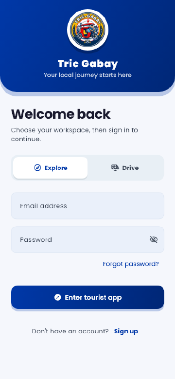
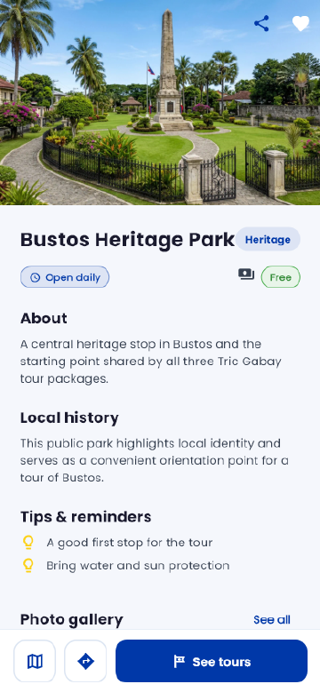
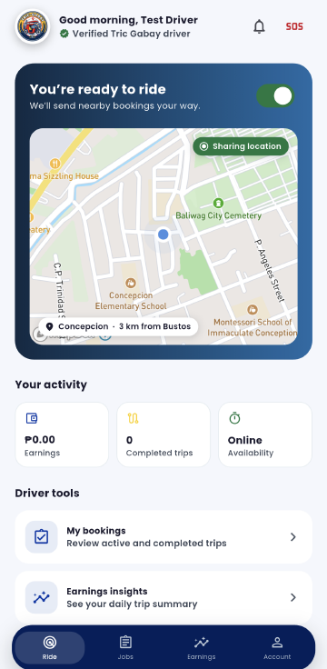
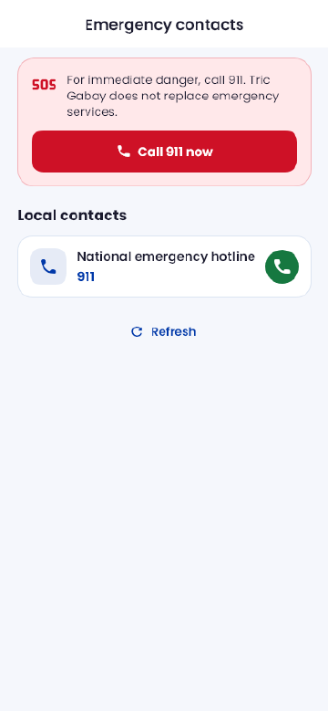

# Tric Gabay

**Tricycle tour booking for Bustos, Bulacan.** Tric Gabay ("tricycle guide") lets
visitors book a fixed-price tricycle tour of Bustos's heritage sites, chapels and
local food stops, matches the booking with an approved local driver, and follows
the trip from pickup to payment. One Flutter app serves three roles: **tourist**,
**driver** and **administrator**.

Built by **Prince Charles Resurreccion ([TraxexCo](https://github.com/TraxexCo))**
as a capstone project.

<p align="center">
  
  
  
  
</p>

## Features

### Tourists
- Browse the places on the tour routes on a map or in a list, with photos,
  history and visiting tips.
- Book one of three ready-made tour packages (TRIC LAKBAY, TRIC SAYA,
  TRIC TUKLAS) at a fixed, agreed fare: no distance, waiting or surge charges.
- Pick a tour day and start time (Monday to Friday, office hours, holidays
  excluded), up to a year ahead.
- Every tour starts and ends at the Bustos Municipal Arts, Culture and Tourism
  Office.
- See the assigned driver live on the map, and confirm the driver with a 4-digit
  pickup code.
- Pay in cash or by GCash directly to the driver (scan their QR or open GCash).
- Rate the driver, save places, read booking history, and reach emergency
  contacts with one tap.

### Drivers
- Apply with licence and vehicle documents; go online once approved.
- Receive ride offers by push notification, accept them, and navigate to the
  pickup.
- Verify the pickup code, confirm each stop, and complete the trip.
- Confirm payment with a slide-to-confirm control, or flag a GCash payment that
  did not arrive.
- Track earnings and trip history.

### Administrators
- Dashboard of today's bookings, active drivers, alerts and disputes.
- Approve or suspend drivers after reviewing their documents and expiry dates.
- Create, edit, reorder and retire tour packages and their prices. Price changes
  are versioned, so existing bookings keep their agreed fare.
- Manage places, emergency contacts and announcements.
- Rule on disputed GCash payments. An unpaid ruling blocks the tourist's new
  bookings until it is settled or waived.
- Handle data-export requests (Data Privacy Act).

### Across the app
- English and Filipino, with every string translated.
- Accessibility checks on every screen: text scaling, tap target sizes and
  contrast.
- Works on a weak connection: shows saved data first, refreshes in the
  background, and explains failures.

## Tech stack

| Layer | Technology |
| --- | --- |
| App | Flutter (Dart), Riverpod, go_router, gen_l10n (English/Filipino) |
| Backend | Supabase: Postgres with row-level security, SQL functions for every money and trip rule, Storage, Realtime, Edge Functions (Deno), pg_cron |
| Maps | Mapbox Maps SDK, plus Mapbox Directions and Geocoding |
| Notifications | Firebase Cloud Messaging, with optional Crashlytics and Performance |
| Payments | Cash and direct GCash between tourist and driver. The app records payments and never holds money. |
| Testing | Flutter widget and accessibility tests, pgTAP database suites, and an authorization matrix that checks every table and function for each role |

## Setup

**API keys are not in this repository.** Each developer supplies their own in a
git-ignored config file.

1. Install Flutter (Dart SDK 3.12 or newer), then run `flutter pub get`.
2. Copy the example config:
   ```bash
   cp config/dev.example.json config/dev.json
   ```
   or name the copy `config/phone-test.json`. Every `config/*.json` file except
   the `.example` ones is git-ignored.
3. Fill in your own values:

   | Key | Where to find it |
   | --- | --- |
   | `SUPABASE_URL`, `SUPABASE_PUBLISHABLE_KEY` | Supabase dashboard, Project Settings → API (the publishable or anon key, never the service-role key) |
   | `MAPBOX_PUBLIC_TOKEN` | Mapbox account, Tokens (a public `pk.` token) |
   | `FIREBASE_API_KEY`, `FIREBASE_APP_ID`, `FIREBASE_MESSAGING_SENDER_ID`, `FIREBASE_PROJECT_ID` | Firebase console, Project settings → your Android app |
   | `APP_ENV` | `dev`, `staging` or `production`; must match the Android flavor you build |
   | `AUTH_APP_LINK_HOST` | The domain used for password-reset links |

4. Set up the database: apply `supabase/migrations/` to your Supabase project
   (`supabase db push`).
5. Run or build with the matching flavor:
   ```bash
   flutter run --flavor dev --dart-define-from-file=config/dev.json
   ```
   ```bash
   flutter build apk --debug --flavor production --dart-define-from-file=config/phone-test.json
   ```

Release builds also need your own signing key in `android/key.properties`, which
is git-ignored. See [docs/backend-setup.md](docs/backend-setup.md) and
[DEPLOYMENT.md](DEPLOYMENT.md) for the full backend and release setup.

## Tests

```bash
flutter analyze
```

```bash
flutter test
```

The database suites (`supabase/tests`) and the authorization matrix run against
an isolated local Supabase stack in Docker. See [TESTING.md](TESTING.md).

## Project documentation

- [ARCHITECTURE.md](ARCHITECTURE.md), [SECURITY.md](SECURITY.md),
  [TESTING.md](TESTING.md), [DEPLOYMENT.md](DEPLOYMENT.md),
  [OPERATIONS.md](OPERATIONS.md), [KNOWN_ISSUES.md](KNOWN_ISSUES.md),
  [RELEASE_CHECKLIST.md](RELEASE_CHECKLIST.md)
- [docs/gcash-direct-payment.md](docs/gcash-direct-payment.md): how payments
  and disputes work.
- [docs/real-world-scenarios.md](docs/real-world-scenarios.md): usage scenarios
  in Bustos.
- [docs/booking-scenario-review.md](docs/booking-scenario-review.md): booking
  rules.
- Demo data for presentations: `supabase/seed/demo_seed.sql`. Demo accounts
  cannot sign in.

### Dependency pins

- `share_plus: 13.1.0`: 13.2+ fails to build with this app's Gradle/Kotlin
  toolchain.
- `mapbox_maps_flutter: 2.30.1`: keeps the tested native SDK; v3 needs a
  separate migration.

## Credits

Designed and developed by **Prince Charles Resurreccion**
([TraxexCo](https://github.com/TraxexCo)) as a capstone project for tricycle
tours in Bustos, Bulacan.
