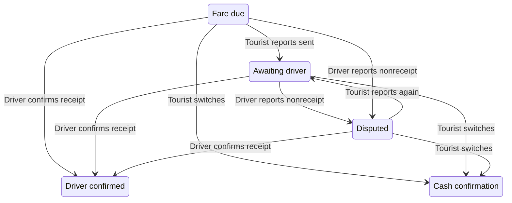

# Direct GCash payment

Tric-Gabay lets a tourist send the fare directly to the assigned driver through the GCash app. Cash remains the default at booking. The existing PayMongo test checkout is also available.

## Tourist, driver and admin

- **Driver** opens **Account → GCash payment details**, enters their GCash number twice and enters the registered account name. They can enable or disable the option. The app accepts `09XXXXXXXXX` and `+639XXXXXXXXX` and stores the matching local `09XXXXXXXXX` form.
- **Tourist** chooses **GCash (send to driver)** on the fare summary. Driver dispatch uses the same timing as a cash booking. Once the assigned driver completes the trip and the saved final fare is due, trip payment shows the fare, the driver's active GCash details and a reminder to check the recipient name in GCash.
- **Tourist** taps **Open GCash**, or copies the number and fare to use in GCash. The copyable amount uses plain decimal format (for example, `150.00`). They may report sending the fare and supply an optional 8–20 character alphanumeric reference.
- **Driver** gets a booking notification through the existing push queue when a tourist reports sending the fare. The driver checks their own GCash account, then slides to confirm receipt. A screen-reader action is available. The driver may confirm without the tourist report. Only driver confirmation records a paid direct GCash fare.
- **Driver** may report **Not received yet** and add a short note. The tourist can check the GCash receipt, report sending again with a reference, or switch to cash.
- **Admin** can open GCash details from a single driver's compliance page. Disputed GCash payments appear in the existing booking monitor's payment filter. The optional admin review flag is omitted.

If the driver's GCash details are inactive or absent, the tourist gets a cash fallback. Switching clears direct GCash dispute and confirmation data before opening the usual two-party cash confirmation flow. If money was already sent, the tourist should check the receipt with the driver before paying in cash.

## Payment states

The booking stores the coarse payment state. The driver action uses the saved final charge in centavos, creates one `payments` row, and records who confirmed and when. Direct GCash has its own paid status and creates no financial ledger entry.

## RPCs and access

| RPC | Authorized caller | Effect |
| --- | --- | --- |
| `get_booking_driver_gcash` | Booking tourist | Reads the assigned driver's active account name, number and saved final charge while direct GCash is due |
| `get_booking_gcash_reference` | Assigned driver | Reads the optional reported reference for the completed booking |
| `tourist_mark_gcash_sent` | Booking tourist | Records the report and optional reference and queues a push once per awaiting-confirmation cycle |
| `driver_confirm_gcash_received` | Assigned driver | Records receipt once and marks the fare paid |
| `driver_flag_gcash_not_received` | Assigned driver | Marks the fare disputed and records an optional note |
| `tourist_switch_gcash_to_cash` | Booking tourist | Clears direct GCash state and starts the existing cash confirmation path |

Driver details live in `driver_gcash_details`, outside the public driver directory. RLS allows a driver to read and edit their own row and admins to read it. The private `gcash_payment_confirmations` table is accessed through scoped RPCs. The mutations require an active account, an assigned driver, a completed booking and a positive saved final charge. They lock the booking before writing so cash fallback and GCash confirmation cannot both succeed. Cancelled trips never enter this payment screen.

The existing booking realtime events carry the coarse status. Neither private table is added to realtime. Numbers, account names, dispute notes and reference numbers are kept out of push content and the app's logs and telemetry. Push uses the existing notification and dispatch infrastructure.

## Limitations

- Payment confirmation is manual. The tourist report does not prove payment. The driver checks GCash and confirms receipt.
- The driver's number is not verified by a GCash or PayMongo API.
- Send Money prefill is unconfirmed. The launcher attempts `gcash://`, and the payment screen keeps copy available if launch fails. Check actual behavior on the device.
- Tric-Gabay does not hold or forward money. It does not charge a commission or a fee on this flow.

The pgTAP regression is `supabase/tests/023_gcash_direct_payment.sql`. On a disposable local Supabase stack, apply the migrations with `supabase db reset`, then run `supabase test db`. Flutter coverage is in `test/gcash_direct_payment_test.dart`. See [Physical phone testing](physical-phone-testing.md) for the device checklist.
